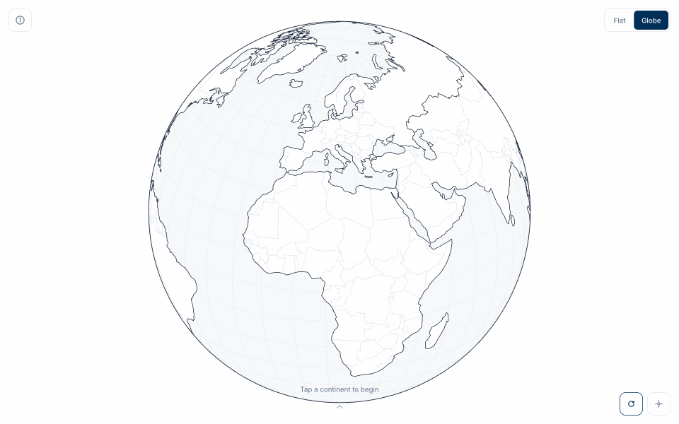
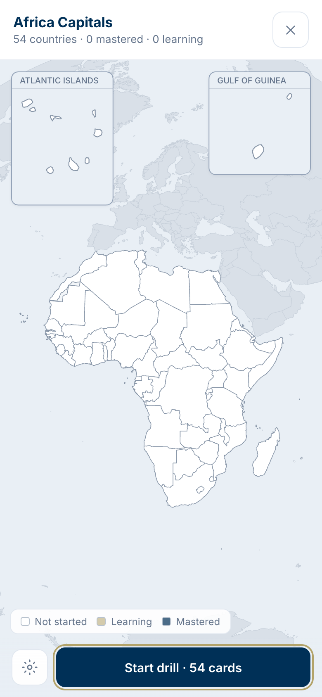
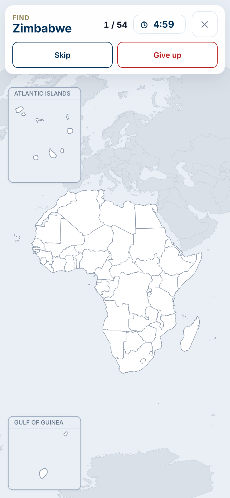
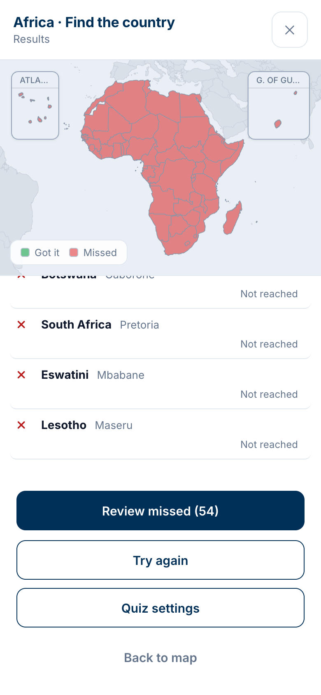

<div align="center">

# Capitals

**Learn Capitals**

Map-first trainer for world capitals — drill by continent, quiz on the map, unlock the world as you master it.

[](https://learncapitals.vercel.app)
[](https://react.dev)
[](https://vite.dev)
[](https://www.typescriptlang.org)
[](https://tailwindcss.com)

**[Try it live →](https://learncapitals.vercel.app)**

<br />



</div>

<br />

## Features

<table>
<tr>
<td width="33%" align="center" valign="top">



**Learn on the map**

Open a continent and run flashcards, multiple choice, or type-it drills — country ↔ capital, either direction.

</td>
<td width="33%" align="center" valign="top">



**Quiz on the map**

Find the country by tapping the map, or name the capital — with timers, hard mode, and review of misses.

</td>
<td width="33%" align="center" valign="top">



**Mastery unlocks World**

Map tint shows what you know. Master countries (2 correct) and unlock the full world at 80% — progress stays in your browser.

</td>
</tr>
</table>

Built as a mobile-first geography learning loop.

## Stack

- **React 19** + **Vite** + **TypeScript**
- **D3** + **world-atlas** for the globe and flat map
- **Tailwind CSS v4** + **shadcn/ui**
- Deployed on **Vercel** ([learncapitals.vercel.app](https://learncapitals.vercel.app))

## Quick start

```bash
git clone https://github.com/tobi-obitayo/capitals-app.git
cd capitals-app
npm install
npm run dev
```

## License

[MIT](LICENSE)
